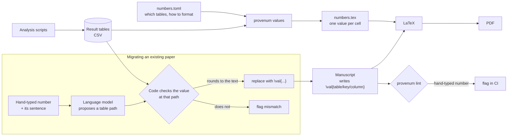

# provenum

Every number in your manuscript should know where it came from.

When an analysis is rerun, or a paragraph is rewritten by hand or by an AI assistant, numbers in
the prose drift away from the analysis output. provenum ties them back together. It works from
the result tables your analysis writes (CSV), not from the typeset paper, so it catches a wrong
table as well as a wrong sentence.

> **Status: early prototype.** The interfaces may change. It has been tested on one manuscript so
> far (see [Evaluation](#evaluation)).

## How it works



The analysis writes tables; provenum turns every table cell into a value the manuscript can
reference, so rerunning the analysis updates the text. For a paper that already has numbers typed
by hand, a language model proposes which value each number reports, and the code accepts the
proposal only if the value at that address matches what is written.

## What it does

| Command | What it is for |
|---|---|
| `provenum values` | Generate LaTeX values from your tables, so the text writes `\val{comparisons/vina/top1/box_padding_2/delta_pts}` instead of a hard-coded `+6.8`. Rerun the analysis and the text follows. |
| `provenum lint` | List numbers still typed by hand. With `--strict`, fail CI if any remain. |
| `provenum migrate` | Replace hand-typed numbers with `\val{}`, but only where the value from the data reproduces exactly what is written. |
| `provenum audit` | Check numbers against the tables by their surrounding words, without changing the manuscript. |

An undefined `\val{}` path prints a bold **??** in the PDF and a LaTeX warning, so a broken
reference cannot slip through.

## Quick start

```bash
pip install git+https://github.com/David-Alobo/provenum

# 1. Describe which tables to expose and how to format them (see examples/dockprepbench_values.toml)
# 2. Generate the values and load them in the preamble with \input{tables/numbers}
provenum values numbers.toml --tables paper/tables --out paper/tables/numbers.tex
# 3. Write numbers as \val{<table>/<key>/.../<column>} and keep the build honest
provenum lint paper/sections/*.tex --strict
```

A spec names each table, the columns that identify a row, and a format per column:

```toml
[[table]]
file = "comparisons.csv"
keys = ["engine", "metric", "arm"]
default = "pct1"                      # proportions shown as percentages, one decimal
formats = { delta_pts = "+f1", p_holm = "p", gained = "int" }
```

Formats: `pct0` to `pct2`, `f0` to `f4`, `sig2`, `sig3`, `int`, `p` (two significant figures,
scientific below 0.001), and a `+` prefix to always show the sign.

## How the AI step is kept honest

Migrating an existing paper needs to know which table value each number reports. A language
model is good at that reading, but it should not be trusted to say a number is right. In
provenum the model only **proposes** an address (`summary/vina/box_padding_2/top1`); the code
looks up the value and **verifies** that it rounds to the written number. A wrong guess costs
coverage, never correctness.

## Evaluation

On the Results section of the DockPrepBench manuscript (307 decimal numbers), each number was
corrupted by three units in its last digit to measure how many errors each approach catches:

| Approach | Corrupted numbers caught | Correct numbers flagged |
|---|---|---|
| Match by value alone | 1% | 0 |
| Match by surrounding words | 20% (88% where anchored) | 44 |
| Model proposes, code verifies | 134 of 134 anchored | 0 |

Migration replaced 124 numbers with `\val{}`, and the compiled PDF text was identical before and
after. The audit also found 28 numbers that no generated table produces.

## Related tools

- [statcheck](https://statcheck.io/) recomputes p-values from reported test statistics (APA format).
- [sciwrite-lint](https://arxiv.org/abs/2604.08501) checks citations and, with a language model,
  whether numbers in the text agree with the paper's own tables.
- Prose linters such as [Vale](https://github.com/jdkato/vale) check wording, not numbers.

provenum differs in checking against the analysis output rather than the typeset paper, in
preventing drift by generating the numbers, and in never letting a model certify a value.

## Roadmap

**Done**

- [x] Values from result tables (`values`), hand-typed number check (`lint`), safe replacement
  (`migrate`) and context audit (`audit`)
- [x] Model proposes, code verifies: anchoring with a language model whose answers are checked
  against the table value
- [x] Local models through Ollama, so a manuscript never has to leave your machine
- [x] Benchmark of eight local models (Qwen2.5, Qwen3, Llama) against a gold standard of 311
  numbers
- [x] First real migration: 312 of 369 decimal numbers in the DockPrepBench results now come from
  data, with identical PDF text

**In progress**

- [ ] Fine-tuned anchoring model: Qwen3-32B trained on synthetic papers from 48 fields, tested on
  held-out fields and on DockPrepBench
- [ ] GitHub Action that fails a build when the values file is out of date with the tables
- [ ] Release on PyPI (`pip install provenum`)
- [ ] Methods paper (arXiv preprint)

**Next**

- [ ] Publish the fine-tuned adapter and its training data on Hugging Face, and make it the
  default model for `provenum anchor`
- [ ] Two-model agreement for migrations: accept a cell only when two models choose it
- [ ] Validation on manuscripts by other authors, in other fields
- [ ] A smaller fine-tuned model that runs on a laptop GPU
- [ ] OpenAI-compatible backend, for hosted models and local servers other than Ollama

**Later**

- [ ] Editor support: VS Code extension and an Overleaf workflow
- [ ] Short demo (GIF) of migrating a paper

Suggestions and issues are welcome on the
[issue tracker](https://github.com/David-Alobo/provenum/issues).

## Development

```bash
uv run pytest
uv run ruff check src tests
```

## Licence

MIT. See [LICENSE](LICENSE).
