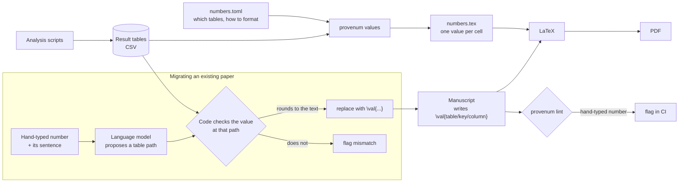

# provenum

Every number in your manuscript should know where it came from.

When an analysis is rerun, or a paragraph is rewritten by hand or by an AI assistant, numbers in
the prose drift away from the analysis output. provenum ties them back together. It works from
the result tables your analysis writes (CSV), not from the typeset paper, so it catches a wrong
table as well as a wrong sentence.

> **Status: early prototype.** The interfaces may change. It has been tested on one manuscript so
> far (see [Evaluation](#evaluation)).

## How it works



The analysis writes tables; provenum turns every table cell into a value the manuscript can
reference, so rerunning the analysis updates the text. For a paper that already has numbers typed
by hand, a language model proposes which value each number reports, and the code accepts the
proposal only if the value at that address matches what is written.

## What it does

| Command | What it is for |
|---|---|
| `provenum values` | Generate LaTeX values from your tables, so the text writes `\val{comparisons/vina/top1/box_padding_2/delta_pts}` instead of a hard-coded `+6.8`. Rerun the analysis and the text follows. |
| `provenum lint` | List numbers still typed by hand. With `--strict`, fail CI if any remain. |
| `provenum migrate` | Replace hand-typed numbers with `\val{}`, but only where the value from the data reproduces exactly what is written. |
| `provenum audit` | Check numbers against the tables by their surrounding words, without changing the manuscript. |
| `provenum diff` | After a rerun, list the sentences whose numbers changed and flag the changes that can break a claim. |
| `provenum init` | Write a starting spec from a folder of tables, with each guess explained. |
| `provenum check` | Check that the words around each number still match it: guards you write, such as `\val[>0]{...}`, and common phrasings such as "rose from X to Y" or "significant". |

An undefined `\val{}` path prints a bold **??** in the PDF and a LaTeX warning, so a broken
reference cannot slip through.

### After a rerun

The numbers update themselves; the words around them do not. `provenum diff` compares the
regenerated values with the committed ones and shows each affected sentence once, with every
changed number as `[old -> new]`. It flags a difference that changes sign, a p-value that crosses
the significance level (`--alpha`, default 0.05), an interval that starts or stops including
zero, and a cited value that no longer exists.

```text
$ provenum values numbers.toml --tables paper/tables --out paper/tables/numbers.tex
$ provenum diff paper/tables/numbers.tex --manuscript paper/sections/*.tex
provenum diff: 7 cited value(s) changed in 3 sentence(s); 3 need a look

results.tex:2  NEEDS A LOOK
    Vina's top-1 success rose from 46.3% to [53.0 -> 47.9]% with the 2 Å box ([+6.8 -> +1.6]
    points [[3.5 -> -1.2], [10.0 -> 4.4]]; Holm p = [4.1e-04 -> 0.31]).
    ! cmp/vina/box2/delta_low: 3.5 -> -1.2: sign changed; interval now includes 0
    ! cmp/vina/box2/p_holm: 4.1e-04 -> 0.31: now not below 0.05
```

The old values come from git (`--rev`, default `HEAD`) or a file (`--old`). `--format markdown`
writes a report for a pull-request comment, and `--strict` exits with an error when a cited claim
needs a look.

### Claims, not just numbers

`provenum check` reads the manuscript with the current values. A claim that matters can carry a
guard, which LaTeX ignores and `check` enforces:

```latex
The 2~\AA{} box raised success by \val[>0]{comparisons/vina/top1/box_padding_2/delta_pts} points
(Holm $p = \val[<0.05]{comparisons/vina/top1/box_padding_2/p_holm}$).
```

A guard is one or more comparisons (`>`, `>=`, `<`, `<=`, `=`, `!=`) against a number or another
path, e.g. `\val[>summary/vina/baseline/top1]{...}`. A failed guard is an error.

Without guards, `check` also warns about common phrasings that contradict the values: "rose from X
to Y" with X above Y (or "fell" with X below Y), a direction word followed by a change of the
opposite sign, and "significant" or "not significant" contradicted by the p-value cited after it.
These are heuristics. On the DockPrepBench manuscript they raise no warnings on its real values;
with every sign flipped they flag 5 sentences, and with every p-value moved across 0.05 another 5.

### Getting started on your own tables

`provenum init` writes a starting spec from a folder of CSV tables, with every guess explained in a
comment: text columns name the row (labels they determine and True/False columns are left out), p
and `p_*` columns are p-values, values between 0 and 1 are proportions shown as percentages,
differences show their sign, and AUROC-like scores stay decimals.

```bash
provenum init paper/tables --out numbers.toml
```

On the 28 tables behind the DockPrepBench results, the guessed keys matched the hand-written spec
for 26 tables and the guessed formats for 223 of 237 columns (94%); 11 of the 14 differences were
only whether a difference shows its "+" sign.

### Numbers computed in code

A number computed in a script or notebook, such as a ratio, often never reaches a results table,
so nothing can trace it. Record it where it is computed:

```python
import provenum

provenum.record("vina_vs_gnina/ratio", gnina_rate / vina_rate, fmt="f1")
```

This writes `recorded.csv` (or `$PROVENUM_RECORD`) with the name, value, format and the file that
recorded it; recording a name again replaces it, so rerunning a cell adds no duplicates. The text
writes `\val{recorded/vina_vs_gnina/ratio}`, and `provenum init` adds the table to the spec.

## Quick start

```bash
pip install git+https://github.com/David-Alobo/provenum

# 1. Describe which tables to expose and how to format them (see examples/dockprepbench_values.toml)
# 2. Generate the values and load them in the preamble with \input{tables/numbers}
provenum values numbers.toml --tables paper/tables --out paper/tables/numbers.tex
# 3. Write numbers as \val{<table>/<key>/.../<column>} and keep the build honest
provenum lint paper/sections/*.tex --strict
```

A spec names each table, the columns that identify a row, and a format per column:

```toml
[[table]]
file = "comparisons.csv"
keys = ["engine", "metric", "arm"]
default = "pct1"                      # proportions shown as percentages, one decimal
formats = { delta_pts = "+f1", p_holm = "p", gained = "int" }
```

Formats: `pct0` to `pct2`, `f0` to `f4`, `sig2`, `sig3`, `int`, `p` (two significant figures,
scientific below 0.001), and a `+` prefix to always show the sign.

## How the AI step is kept honest

Migrating an existing paper needs to know which table value each number reports. A language
model is good at that reading, but it should not be trusted to say a number is right. In
provenum the model only **proposes** an address (`summary/vina/box_padding_2/top1`); the code
looks up the value and **verifies** that it rounds to the written number. A wrong guess costs
coverage, never correctness.

## Evaluation

On the Results section of the DockPrepBench manuscript (307 decimal numbers), each number was
corrupted by three units in its last digit to measure how many errors each approach catches:

| Approach | Corrupted numbers caught | Correct numbers flagged |
|---|---|---|
| Match by value alone | 1% | 0 |
| Match by surrounding words | 20% (88% where anchored) | 44 |
| Model proposes, code verifies | 134 of 134 anchored | 0 |

Migration replaced 124 numbers with `\val{}`, and the compiled PDF text was identical before and
after. The audit also found 28 numbers that no generated table produces.

## Related tools

- [statcheck](https://statcheck.io/) recomputes p-values from reported test statistics (APA format).
- [sciwrite-lint](https://arxiv.org/abs/2604.08501) checks citations and, with a language model,
  whether numbers in the text agree with the paper's own tables.
- Prose linters such as [Vale](https://github.com/jdkato/vale) check wording, not numbers.

provenum differs in checking against the analysis output rather than the typeset paper, in
preventing drift by generating the numbers, and in never letting a model certify a value.

## Development

```bash
uv run pytest
uv run ruff check src tests
```

## Licence

MIT. See [LICENSE](LICENSE).
